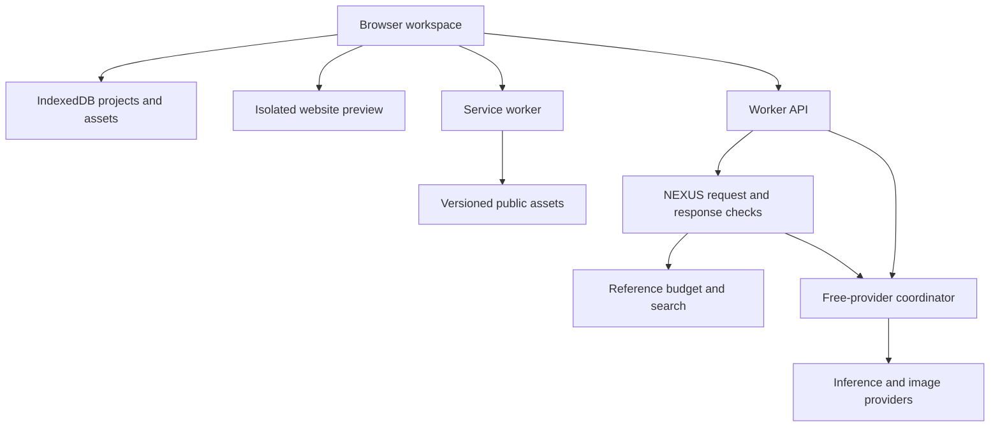

# OMNIFORGE foundation engineering

ADEN INC. · MICHELLE · NEXUS

## Baseline and scope

The starting release was v0.11.5, build `0.11.5-9080ac5c3c67`, at commit `79ab1726bb30aead1ab72332323dcd27d62c40f7`. Production reported that source commit in `/build-info.json`. The initial review found no open pull requests. Unmerged tips `2fa044e` and `7e4b8d4` contain provider fixes superseded on main. Tip `2258f17` is the retired one-time acceptance workflow. The stabilization changes use an isolated branch and preserve the Worker name, binding identifiers, Durable Object migration tags and browser database versions.

The baseline passed 203 automated tests, a Worker dry run and the Chromium mobile workflow using provider fixtures. An independent synthetic provider call returned headers and then stalled indefinitely beyond its 20 ms deadline. Inspection confirmed that normal writes and imports removed saved turns older than the most recent 100. A repeatable preview fixture also showed 12 blob reads to render one placed image. These findings determined the order of work.

## Architecture and contracts

The browser owns the user's conversation, projects and attachments. The Worker owns validation and external effects. NEXUS prepares the request and checks the result. The free-provider coordinator owns credentials, provider availability, reservations and queued image jobs.



| Component and entry point | State and effects | Contract, failure boundary and verification |
| --- | --- | --- |
| Startup and navigation, `index.html`, `src/app.js`, `src/offline-ui.js` | The active workspace, UI action queue and selected project are in browser memory. The startup notice reports fatal initialization errors. | Main modules initialize before controls become usable. Missing provider or reference modules leave local projects and the local calculator available. An IndexedDB block can be retried after closing the conflicting tab. Browser smoke covers both paths. |
| Project and conversation, `src/core.js`, `src/app.js` | IndexedDB `omniforge-db` v2 contains `projects`, `assetBlobs` and `prefs`. The active project is an in-memory revision of its database record. | Project plus new blobs commit in one transaction. A revision check rejects stale writes, including legacy records before their first revisioned save. Failed edits preserve saved source. Earlier saved turns remain available on demand. The UI prevents overlapping submissions in one tab. Browser tests cover reload, concurrent edits, failed saves and long histories. |
| Website editing and preview, `src/workspace.js`, `src/projectfiles.js`, `src/core.js` | The three-file code workspace takes precedence over raw HTML, which takes precedence over structured pages. The same source generates preview and export. | Explicit creation or editing may replace source only after validation and a successful save. The preview uses an opaque-origin script sandbox and a CSP restricting resource loads and forms. Model output cannot invoke arbitrary server code. Check the rendered CSS/JS, source comparison, and preservation after rejected edits. |
| Conversation and tools, `worker.js`, `server/nexus.js`, `src/context.js` | A single chat endpoint prepares role-filtered, bounded context. Current source and explicitly selected project material are sent only where the workflow requires them. | User text is limited to 6,000 characters. The body limit is 90 kB for text or 800 kB for a supported photo attachment. Active HTML is limited to 24,000 characters for model edits. The context window includes at most 12 entries and 9,000 characters. Local calculations, project recall, retrieved evidence and live responses carry different receipts. Review checks reject incomplete artifacts and invalid citations. |
| Providers, `server/pool-http.js`, `server/coordinator.js`, `server/providers.js`, `server/catalog.js` | The existing `MIKEE_POOL` Durable Object holds config, usage and image jobs in `pool-v1`. Fixed adapters send prepared requests to eligible services. | Server deadlines cover provider response bodies and enforce byte limits. Worker chat starts with 95 seconds overall and the coordinator uses at most 85 seconds of the remainder. It caps candidate inference calls at five per route, with one bounded existing recovery route for malformed artifact output. Browser chat releases loading state by 110 seconds. Validation, rate limit, provider, timeout and cancellation outcomes remain distinguishable. There is no automatic browser resubmission. |
| Images and audio, `src/pool.js`, `src/app.js`, `server/coordinator.js` | Images are decoded before saving the reply, bytes and metadata together. Audio uses an explicitly chosen upload and returns a transcript draft. | Image prompts are 2–900 characters. Browser image downloads allow PNG, JPEG or WebP up to 2.25 MB in 20 seconds. External queued jobs expire in 10 minutes, are polled no more than once per eight seconds at the coordinator and allow best-effort cancellation. A late result cannot replace confirmed cancellation. Audio accepts the supported media types and up to 2 MiB. Provider cancellation and refunds depend on the upstream service. |
| Search and local knowledge, `research.js`, `src/offline.js` | Wikipedia REST/Action and optional Tavily use fixed search APIs. Local XML and preferences use `omniforge-local-knowledge` and the local-mode preference. | Reference calls have a 6.5-second deadline and 95 kB response cap. A lookup can use up to two queries and return up to four excerpts. Retrieval errors preserve the project. Source markers indicate cited evidence. The local tools do deterministic calculation and reference lookup. |
| Backup and restore, `src/core.js`, `src/backup.js` | ZIP and JSON contain the current project, chat, notes, source and image data. Project and image IDs are remapped on import. | Restore accepts up to 55 MiB per file, 3,000,000 bytes of ZIP metadata, and up to 60 photos at 8 MiB each. Export checks the corresponding limits before offering the download. Missing data and interrupted transactions leave existing records intact. Portable backups omit revision markers and undo history. |
| Releases and offline shell, `build.mjs`, `sw.js` | The build records the source SHA, version and asset digest. The service worker keeps a complete current and preceding shell. | Root and each integrity-checked asset must be present before a new shell activates. Navigation allows five seconds, scripts and styles 15 seconds, and reference refresh eight seconds. A failed install or network/cache error leaves the last available complete shell usable. The browser upgrade suite checks both controller and page build IDs. |

The tight browser dependency is the order of script initialization through `window.OMNI`. Preview and archive validation depend on the shared active source. IndexedDB and the persistent coordinator are single points for local durability and cloud allowance accounting respectively. Keep the existing browser boundaries, the one chat path and the fail-closed quota coordinator. Legacy `omniforge_site` remains in local storage after its one-time import. This release requires no storage migration.

## Prioritized corrections and residual risk

| Priority and evidence | User impact and likelihood | Correction, scope and release treatment |
| --- | --- | --- |
| High · stalled provider response after headers | Request remained pending in a local reproduction. Slow or incomplete connections make this plausible in normal use. | Bound fetch and body read, abort cleanup and carry the deadline through routing and recovery. Medium scope across provider transport, coordinator and chat. Deadline regression required. |
| High · 100-turn slice on saves and imports | Deterministic loss on a conversation's 101st turn under the older write path. | Retain saved turns, paginate the UI and keep model context bounded. Medium scope in project, UI and backup. A 103-message round trip is required. |
| High · cache read can fail before network fallback | Can block startup on a browser with broken CacheStorage. | Handle cache reads as best effort and bound navigation, keep integrity checks. Medium scope in service worker. Old browser and simulated update failure regression required. |
| High · optional provider script can block startup | A failed asset load could prevent local use in the same session. | Guard optional cloud/reference modules and leave local startup independent. Small browser change and failure simulation. |
| Medium · rate-limit retry, stale image job and stale preview | Extra requests consume allowance. A late job or preview can display stale work. | Respect `Retry-After`, guard queued terminal state and verify current project before updating the UI. Medium scope. Simulated rate limit, job concurrency and stale save are release gates. |
| Medium · backup output could exceed restore limits | A large or incomplete backup can be unusable when recovery matters. | Validate structure, photo references and file sizes before a portable export succeeds. Medium scope. ZIP/JSON round trips and abort atomicity are release gates. |
| Medium · all photos read during ordinary preview | Every photo added cost even when it was absent from the page. | Load only referenced images in preview. Small browser change. Keep full assets in portable backups. |
| Residual · local storage eviction, no account sync | Device loss, profile clearing or storage pressure can remove the only local copy. | Preserve IndexedDB and export verified backups. Account sync requires a separate privacy and migration design. Existing portability limits remain. |
| Residual · physical-device and provider coverage | Headless tests cover the tested engines. Public readiness signals do not establish live provider availability. | Record exact browser versions and distinguish real calls from fixtures. Treat live vision, audio, broader research and alternative providers as separate acceptance work. |

## Security and budget boundaries

- Assets to protect include projects, uploads, provider keys, account allowance, release configuration and website previews. The trust boundaries are the browser profile, the public Worker API, the owner route, the Durable Objects and outbound services.
- Owner configuration requires the server-side `MIKEE_ADMIN_TOKEN` of at least 24 characters at the Worker and coordinator. Provider keys are stored as Worker secrets or encrypted with AES-GCM in the coordinator. Public status only reports eligibility, timestamps and sanitized diagnostics. The browser holds the owner token in memory for that tab.
- Request types, lengths, origins, known providers and returned image types are checked. Cross-origin restrictions complement server-side authentication. The preview uses sandboxing and escaped UI output. Exported HTML executes in the environment where its recipient opens it and should be treated as untrusted source.
- Cloudflare rate limits are configured at eight visitor and 40 shared chat/audio requests per minute, plus two visitor and four shared image requests per minute. The coordinator uses persisted spacing, concurrency, day/month quotas and a 400-task daily cap. Reference lookup has a separate 24-operation UTC-day cap. Cloudflare's native edge limits are approximate. The persistent budgets are the shared application safeguards.
- The free-only catalog and configured limits remain in place. A provider's current price, quota and owner-account billing settings must be confirmed by the account owner when connecting it. Credential changes, billing, production data and schema changes are outside this release.
- User material attached to an inference request reaches the serving provider. Avoid logging private prompts, keys, tokens, image-job IDs and raw upstream bodies. Public status and receipt metadata suffice for routine diagnostics. A provider can continue executing after a browser cancellation, and an abandoned request does not refund budget already reserved.

## Reproduction and release gates

Use Node 24.22.1 and npm 11.9.0. The clean build needs the existing lockfile. Browser installation is a test-only dependency.

```sh
npm ci
npm run build
npx wrangler deploy --dry-run
npm install --no-save --package-lock=false playwright@1.56.1
npx playwright install chromium
node tests/ui-smoke.mjs
git worktree add --detach ../omniforge-v0115 79ab1726bb30aead1ab72332323dcd27d62c40f7
(cd ../omniforge-v0115 && node build.mjs)
node tests/foundation-browser.mjs upgrade ../omniforge-v0115/public public
node tests/foundation-browser.mjs measure public
```

For the historical engine, point `OMNI_CHROMIUM` to a verified Chromium 83 executable and use `OMNI_LEGACY=1`. The opt-in `tests/live-browser-acceptance.mjs` requires `OMNIFORGE_LIVE_TEST=1` and the exact `OMNIFORGE_EXPECTED_COMMIT`. Use it only for an authorized release with sufficient existing allowance.

| Release invariant | Evidence to reproduce |
| --- | --- |
| Cloud errors leave saved work usable and re-enable the composer | Unit tests hold headers/body pending, simulate quota and malformed responses. The browser fixture checks timeout and a preserved retry draft. |
| Identity and tool receipts reflect the real outcome | Browser tests cover legacy name preferences and MICHELLE's name. Worker tests validate evidence, refusal handling, website completion and image success receipts. |
| Failed edits, saves or restores preserve valid project state | Browser fixture checks stale tabs, interrupted saves and restores, artifact rejection, ZIP/JSON source equivalence and restored photo references. |
| Unknown or unauthorized callers receive no owner configuration | Auth and quota tests check the public routes. An unsigned `GET /api/admin/providers` is expected to return 401 in production. |
| An incompatible or incomplete shell cannot displace a complete one | Chromium upgrade test serves a failing app asset, retries installation, reopens the conversation after a simulated 503 and offline, then serves the previous build and checks the new data. |
| Budget and provider errors stay honest | Simulated free-tier quota, credential failure, missing budget binding and cooldown cover fail-closed behavior. Live receipts are required for any real-provider claim. |

Use zero failures on the deterministic workflows, no unexpected JavaScript errors and exact recovery comparisons as release gates. Track cold startup, New Chat and warm reopen under the same mobile fixture. Initial reference ceilings for that fixture are two seconds for startup/reopen, 500 ms for New Chat, 15 versioned first-load scripts/styles, 320 KiB raw shell code, and a single database blob read for one placed image. Timing is diagnostic until a stable CI runner can sustain repeatable measurements. Production uptime, timeout rate and storage success rate require actual monitoring. The synthetic suite does not yield those rates.

### Local candidate evidence

- v0.11.6 build `0.11.6-9a0697b1b9c7` passed 211 Node tests, the core layout smoke check and Wrangler bundling. Chromium 141.0.7390.37 passed the mobile workflows at 360 × 780, including 13 fixture calls. The upgrade and rollback scenario passed on Chromium 83.0.4103.0 and 141.0.7390.37 with zero uncaught page errors. This is desktop headless browser coverage.
- Five fresh 360 × 780 profiles per release used 4× CPU throttling on loopback. The warm fixture contained 100 messages and 12 assets with one placed photo. Measurements include browser automation overhead.

| Measurement | v0.11.5 | v0.11.6 |
| --- | ---: | ---: |
| Cold startup median | 574 ms | 485 ms |
| New Chat median | 140 ms | 188 ms |
| Saved project reopen median | 578 ms | 460 ms |
| First-load scripts and styles | 15 | 15 |
| Uncompressed shell code | 309,758 B | 318,191 B |
| Preview blob reads per warm run | 12 | 1 |

The synthetic timing does not establish an improvement for New Chat. It remained within the fixture ceiling. Browser-reported heap usage was too coarse for a comparative claim.

## Incident recovery

| Symptom | Safe diagnostic and recovery | Verify before closing |
| --- | --- | --- |
| Blank workspace | Keep the user's existing profile. Read the startup notice. Open a fresh private session and compare its build marker with `/build-info.json`. Close a conflicting older tab if IndexedDB is blocked. Reconnect and reload after an incomplete update. | New Chat and navigation work. The original profile reopens existing saved work. |
| Cloud provider outage | Read the public provider status and any response receipt. Keep drafts and saved projects available. Use local project tools while cloud inference is unavailable. | One authorized bounded live request after recovery. |
| Quota exhausted | Use the displayed retry time or documented UTC reset. Check the provider and shared allowance in the owner's console. Avoid repeated tests during cooldown. | Availability resumes without enabling paid fallback. |
| Bad deployment | Record the failing source and build IDs. Use the last known-good deployment in Cloudflare. Reconcile the Git branch with a reviewed revert when appropriate. Preserve storage and avoid clearing browser data. | Health and manifest identify the intended build. Fresh startup, existing-data reopen and one live request pass. |
| Corrupt project | Leave the original browser copy intact. Restore the latest verified backup into an isolated browser profile. Compare its name, messages, files and assets. | Reopen and check restored content after reload before relying on it. |
| Backup rejected | Save current edits, inspect the file error and sizes, and export again from the original. Export chat Markdown and website source independently if the project exceeds portable archive limits. | A throwaway profile restores the archive and shows equivalent content. |
| Offline update failure | Keep the earlier shell and current profile. Confirm the served build and integrity-checked assets. Retry online and reload once the new worker is active. | Current build marker plus saved data, then an offline reload. |
| Unauthorized access attempt | Confirm the owner route rejects signed-out requests. Review sanitized account logs and keep key rotation within the owner's authorization. | Expected 401 and absence of credentials in the response. |

Rolling back v0.11.6 keeps the IndexedDB schema and stored records. The v0.11.5 write path still truncates long conversations. Export or retain a current v0.11.6 copy before editing those conversations on the older build. The rollback regression exercises reads of data written by the candidate. Existing backups are the only way to recover turns already removed by earlier releases.

## Next capabilities

Extend the existing provider catalog and NEXUS validation contracts when a supported model or tool is ready. A vision or audio provider first needs eligible free credentials, verified input/output and a scoped live acceptance test. User-controlled retrieval would need opt-in, data ownership, deletion, export and project scoping. Multi-step execution would need explicit permissions, checkpoints, cancellation, result verification and approval for consequential effects. Open-weight local inference would need a separately benchmarked compute and storage environment. Those changes depend on an independently verified release and should be proposed in their own review.
